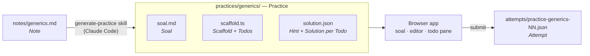

# Code Gym

Turn the notes you write while learning into drills you can redo.

You read about a concept, write a **Note** with annotated code. Code Gym turns that Note into a **Practice**: a task (the **Soal**), incomplete code with numbered gaps (the **Scaffold** and its **Todos**), plus a hint and the solution for each gap. You fill the gaps in the browser, peek at hints only when stuck, submit, and compare your code against the full solution. Every submit is saved as an **Attempt**, so you can see yourself need fewer hints over time.

Open [`docs/explainer.html`](docs/explainer.html) in a browser for the visual walkthrough with a live mini-demo.



## Quick start

Needs [Bun](https://bun.sh) 1.2+.

```sh
bun install
bun run dev        # http://localhost:3000
bun test           # marker parsing, regions, splice, active Todo
```

To add a drill: write `notes/<slug>.md`, then in Claude Code say `generate practice from notes/<slug>.md`. Restart not needed; the home page finds folders containing `solution.json` at any depth under `practices/`. You can group practices by language, for example `practices/typescript/generics/`, accessible at `/p/typescript/generics`.

<details>
<summary><b>The screen</b></summary>

```
┌─────────────┬────────────────────────────────┬──────────────┐
│ # Soal      │ scaffold.ts (editor)           │ TODO-02      │
│             │                                │ declare Box… │
│ what the    │ // TODO-01: declare `first`…   │              │
│ finished    │ function first<T>(…) {…}       │ [hint][reveal│
│ code must   │ // TODO-02: declare `Box<T>`…  │              │
│ do          │ █  ← cursor here = TODO-02     │ hint text    │
│             │                                │ appears here │
│             │                       [submit] │              │
└─────────────┴────────────────────────────────┴──────────────┘
```

- **Left:** the Soal, rendered markdown.
- **Middle:** CodeMirror with the Scaffold. After submit it becomes a diff: your code vs the full solution.
- **Right:** the active Todo, picked by the nearest marker at or above your cursor. `hint` and `reveal` are recorded per Todo.

</details>

<details>
<summary><b>How a Scaffold is parsed</b></summary>

- A **marker** is any line containing `TODO-NN` (two digits). Its title is the text after `TODO-NN:`.
- A Todo's **region** is the lines after its marker up to the next marker or end of file. That region is your answer.
- The **full solution** is the Scaffold with each region replaced by that Todo's `solution`. It is computed on the fly, never stored.

All of this lives in [`src/practice.ts`](src/practice.ts), pure functions with tests in [`src/practice.test.ts`](src/practice.test.ts).

</details>

<details>
<summary><b>Files on disk</b></summary>

```
notes/<slug>.md                                 input to the skill; the app never reads it
practices/<slug>/soal.md
practices/<slug>/scaffold.<ext>
practices/<slug>/solution.json                  { slug, title, language, todos: [{ id, title, hint, solution }] }
practices/<slug>/attempts/practice-<slug>-NN.json
```

An Attempt:

```json
{
  "slug": "generics",
  "attemptNo": 1,
  "submittedAt": "2026-11-03T14:00:00.000Z",
  "code": "<full editor contents>",
  "todos": [{ "id": "TODO-01", "answer": "<your region>", "hintUsed": true, "revealUsed": false }]
}
```

Everything, attempts included, is meant to be committed to git.

</details>

<details>
<summary><b>API</b></summary>

| Route | Does |
|---|---|
| `GET /api/practices` | list `{ slug, title, language, attemptCount }` |
| `GET /api/practices/:slug` | `{ soal, scaffold, solution }` |
| `GET /api/practices/:slug/attempts` | saved Attempts |
| `POST /api/practices/:slug/attempts` | body `{ code, todos: [{ id, hintUsed, revealUsed }] }`, writes the next Attempt |

API slugs are paths relative to `practices/`, such as `generics` or `typescript/generics`. Each path segment must match `^[a-z0-9-]+$`. Keep `solution.json` unchanged when moving a practice. Attempts stay inside that practice’s `attempts/` folder, named using the final path segment (for example `practice-generics-02.json`).

</details>

<details>
<summary><b>What it deliberately does not do</b></summary>

No grading or test running, no Claude API calls from the app, no autosave, no auth, no database. It is a single-user local tool; the judgement of "did I get it" is you reading the diff.

</details>

## Further reading

- [`GLOSSARY.md`](GLOSSARY.md): the exact meaning of Note, Practice, Soal, Scaffold, Todo, Hint, Solution, Attempt.
- [`docs/adr/0001-bun-single-process.md`](docs/adr/0001-bun-single-process.md): why one Bun process serves API and client.
- [`.claude/skills/generate-practice/SKILL.md`](.claude/skills/generate-practice/SKILL.md): the rules the generator follows.
- [`.scratch/code-gym/spec.md`](.scratch/code-gym/spec.md): the original spec.
